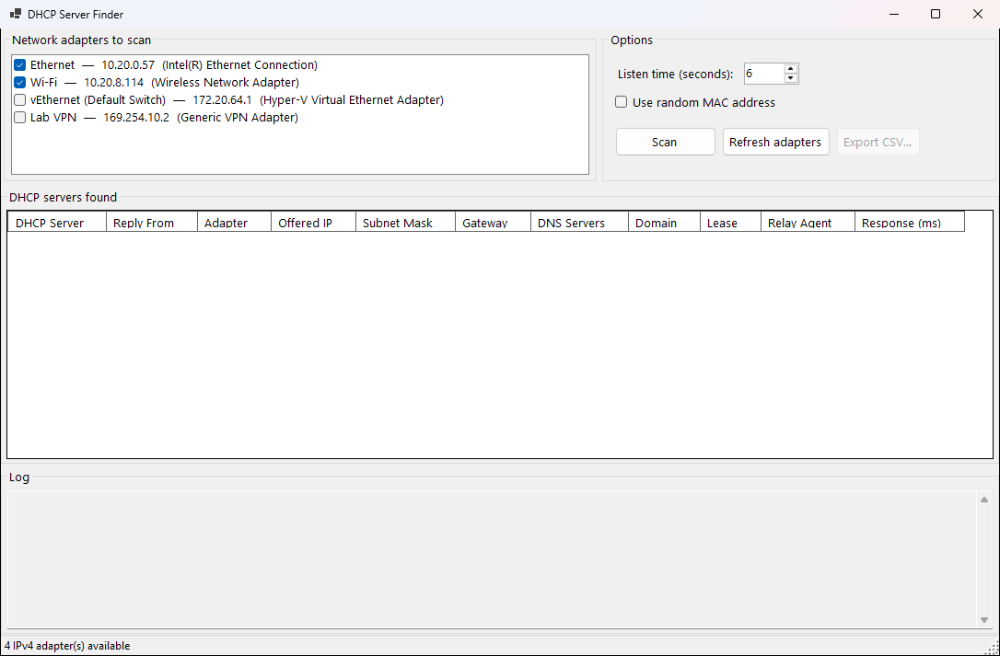
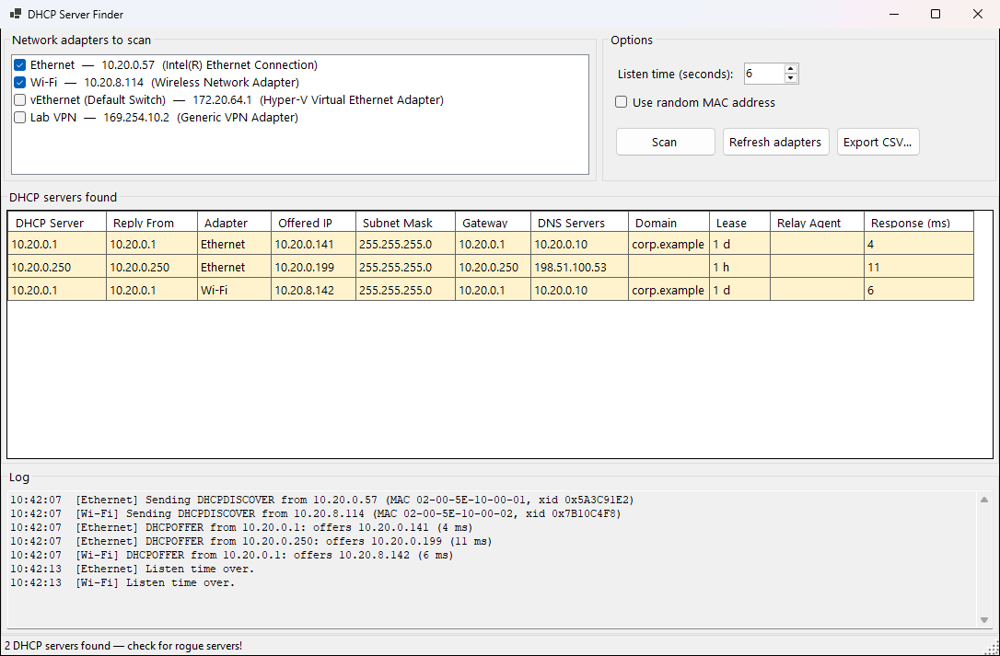

# DHCP Server Finder

A small Windows app that finds every DHCP server reachable from your network adapters — useful for spotting rogue DHCP servers.

[](https://github.com/RowShack/WinTools/releases?q=dhcp-finder-v&expanded=true) &nbsp; **[Download from the release page](https://github.com/RowShack/WinTools/releases?q=dhcp-finder-v&expanded=true)**


*Ready to scan: pick the adapters to probe and set the listen time (demo adapters shown).*


*Two DHCP servers answered, so the rows are highlighted as a possible rogue server (demo data).*

It broadcasts a `DHCPDISCOVER` on each selected adapter and lists every `DHCPOFFER` that comes back. It never sends a `DHCPREQUEST`, so no lease is taken and your network settings are untouched.

## Features

- Pick which IPv4 adapters to scan (virtual/VPN/APIPA adapters are unticked by default)
- Shows server ID, reply source, offered IP, subnet mask, gateway, DNS, domain, lease time, relay agent and response time
- Highlights results when more than one server answers (possible rogue server)
- Optional random MAC address for the probe
- Export results to CSV
- Command-line mode: `DhcpFinder.exe --cli --seconds 6 [--random-mac]`

## Build

Requires the .NET 10 SDK.

```bash
dotnet publish -c Release -r win-x64 --self-contained true -p:PublishSingleFile=true -p:IncludeNativeLibrariesForSelfExtract=true -o publish
```

Output: `publish\DhcpFinder.exe`. Use `--self-contained false` for a small build that needs the .NET 10 Desktop Runtime.

## Notes

- Windows Firewall may prompt on first run — allow it, or replies to UDP port 68 will be blocked.
- Only servers reachable by broadcast (same segment, or via a DHCP relay) can be found.
- Only scan networks you're authorised to scan.
