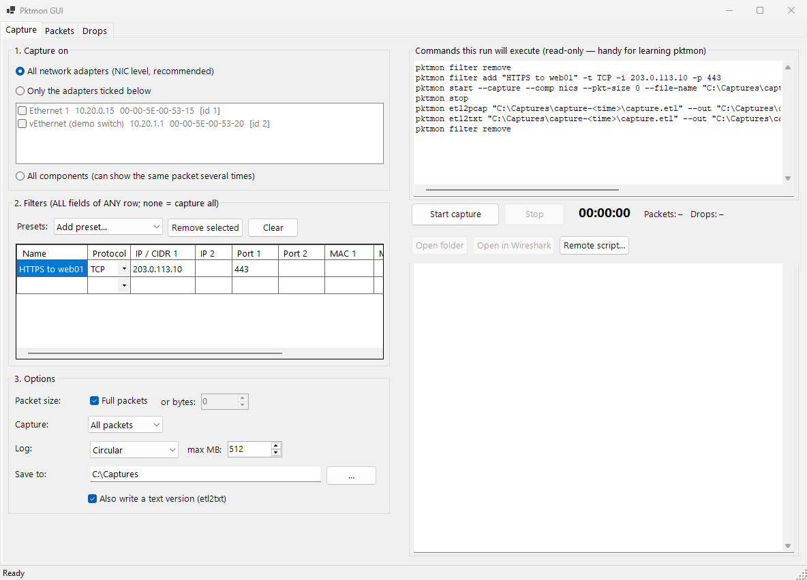
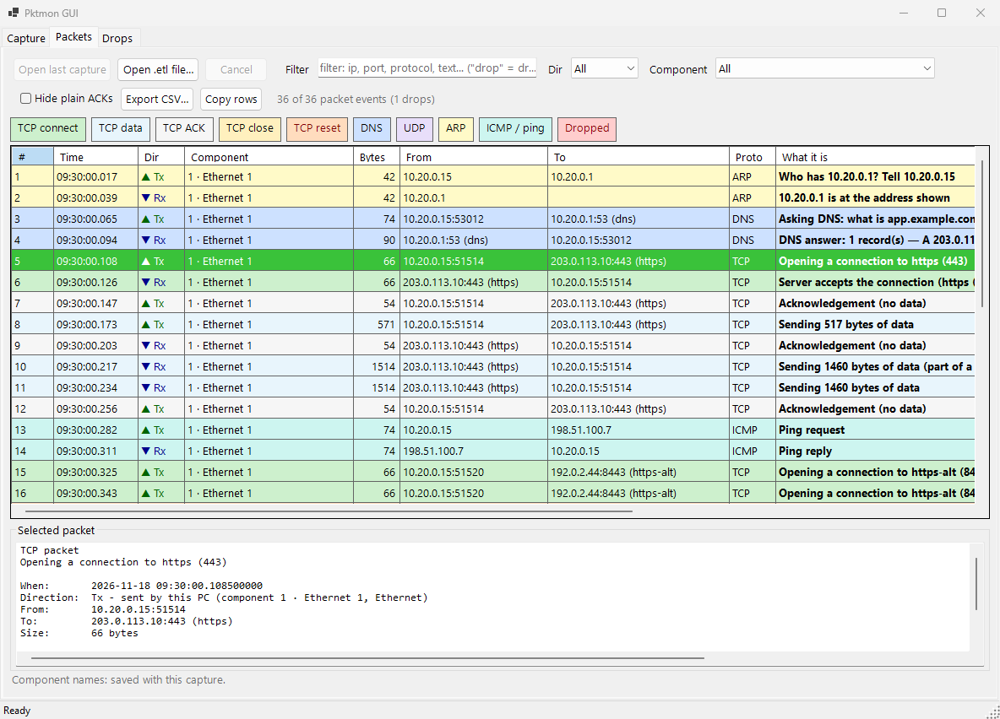

# Pktmon GUI

A front-end for Windows' built-in **Packet Monitor** (`pktmon.exe`) so you can take packet captures on production servers **without installing Wireshark or Npcap**. The app only drives `pktmon.exe`; it installs nothing and loads no driver of its own.

[](https://github.com/RowShack/WinTools/releases?q=pktmon-gui-v&expanded=true) &nbsp; **[Download from the release page](https://github.com/RowShack/WinTools/releases?q=pktmon-gui-v&expanded=true)**


*Capture tab: adapter choice, filters and the exact pktmon commands the run will execute (demo values).*


*Packets tab: colour-coded rows with a plain-English column and a detail pane (demo capture).*

## Features

- Capture on all network adapters (NIC level — avoids the duplicate packets multi-layer captures produce), selected adapters, or all components
- Filter builder: IP/CIDR, port, protocol (TCP/UDP/ICMP/ICMPv6), MAC, VLAN, data link → generates `pktmon filter add` commands. Presets: DNS, DHCP, RDP, SMB, LDAP/Kerberos, HTTPS to one host
- **Read-only commands pane** showing exactly what will run, so you learn pktmon as you go
- Full packets (`--pkt-size 0`), drops-only/flow-only, circular or multi-file log with a size limit
- Start / Stop, elapsed timer, live packet and drop counters
- Stop converts to **pcapng** (`etl2pcap`) in a timestamped folder; optional text export (`etl2txt`); *Open folder*; *Open in Wireshark* if installed
- **Packets tab**: opens a capture (.etl) inside the app — one row per packet event with time, direction, component, source/destination, protocol and decoded info; filter box (words match IPs, ports, protocol, text; `drop` shows drops only), direction and component filters, drops highlighted in red, raw text of the selected packet, copy and CSV export. Uses `pktmon etl2txt`, so it needs the same Windows pktmon but no Wireshark
- **Drops tab**: groups dropped packets by drop reason and component
- **Remote script**: generates a copy-paste PowerShell script (with `try/finally` cleanup) for servers where you can't run the GUI

## Safety

Filters and the capture are always cleaned up: on **Stop**, when the window closes or Windows signs out, and at **next launch** (it offers to stop a leftover capture and clear filters). Flags are only passed if this build's `pktmon start help` lists them; otherwise they are skipped and the log says so.

## Requirements

Windows 10 1809+ (pcapng conversion needs a newer build; the app detects this). **Administrator rights are required** — the exe asks for elevation at start.

## Caveats (please read)

- Output formats of `pktmon list`, `counters`, `status` and `etl2txt` vary between Windows builds. The parsers are defensive and unit-tested against sample text, but have **not** been verified against every build. If the adapter list, counters or Drops tab look wrong on your build, please report a sample.
- Counters shown in the window are best-effort totals.
- pktmon keeps captures per machine, not per user: don't run two instances at once.

## Build

```bash
dotnet test apps/pktmon-gui/tests
dotnet publish apps/pktmon-gui/gui -c Release -r win-x64 --self-contained true -p:PublishSingleFile=true -p:IncludeNativeLibrariesForSelfExtract=true -o apps/pktmon-gui/publish
```

For UI testing without elevation: `dotnet build apps/pktmon-gui/gui -p:UseAdminManifest=false`.
