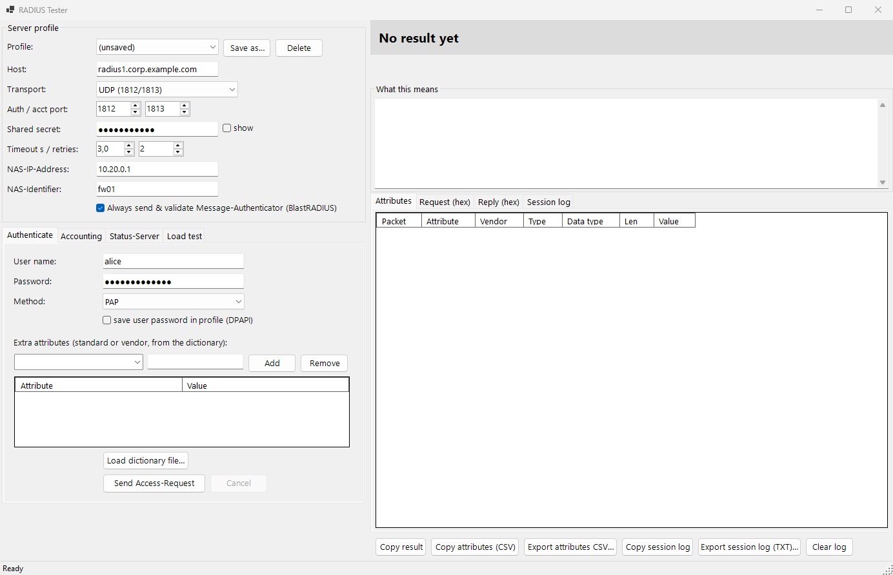
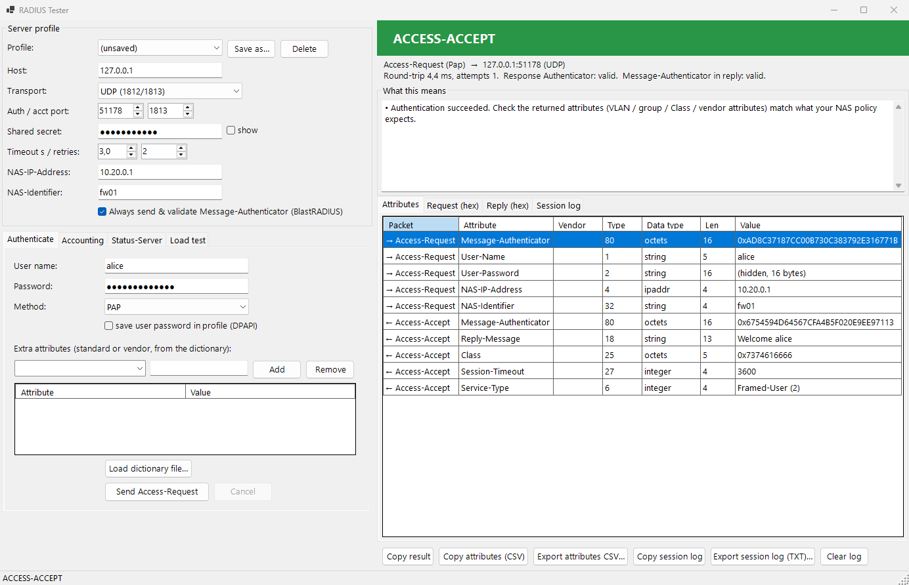

# RADIUS Tester

A GUI RADIUS client for testing RADIUS servers and NAS integrations: FortiGate, NPS, FreeRADIUS, and MFA proxies such as Okta, Duo or Rublon. It tells you *why* a test failed, not just that it did.

[](https://github.com/RowShack/WinTools/releases?q=radius-tester-v&expanded=true) &nbsp; **[Download from the release page](https://github.com/RowShack/WinTools/releases?q=radius-tester-v&expanded=true)**


*Ready to use: server profile and the Authenticate tab (demo values, secret and password masked).*


*Result of an Access-Request against a local demo server: verdict, explanation and the request and reply attributes.*

## Features

- **Server profile**: host, auth port (1812), accounting port (1813), shared secret, timeout, retries, NAS-IP-Address and NAS-Identifier. Saved profiles keep the shared secret (and optionally the test user's password) encrypted with Windows DPAPI for your user account only.
- **Authentication**: PAP, CHAP, MS-CHAPv2 and EAP-MD5.
  - `Message-Authenticator` is always sent (as the first attribute) and validated on replies, as hardening against BlastRADIUS (CVE-2024-3596). A toggle turns this off for legacy servers.
  - MS-CHAPv2 also checks the server's `MS-CHAP2-Success` value (mutual authentication) and decodes `MS-CHAP-Error` (`E=691` wrong password, `648` expired, `647` disabled, ...).
- **Challenge / response (MFA)**: on an `Access-Challenge` the `Reply-Message` is shown and you are prompted for the OTP; it is then sent back as PAP with the `State` attribute echoed automatically. Repeats for multi-step challenges.
- **Accounting**: Start / Interim-Update / Stop with `Acct-Session-Id`, `User-Name`, `Framed-IP-Address`, `Class`, `Calling-Station-Id` and session time. Suited to FortiGate RSSO testing.
- **Status-Server** (RFC 5997) ping: proves the server is alive and the shared secret matches, with no user credentials.
- **Custom attributes**: add any standard or Vendor-Specific attribute from a dictionary (names, enumerated values, IPs, hex, dates). Built-in dictionaries: standard RFC attributes plus **Microsoft (311)**, **Fortinet (12356)** and **Cisco (9)**. **Load dictionary file…** accepts FreeRADIUS-format dictionaries (`ATTRIBUTE`, `VALUE`, `VENDOR`, `BEGIN-VENDOR`/`END-VENDOR`, `$INCLUDE`). Unknown attributes can be given as `Attr-<n>` or `Vendor-<id>-Attr-<n>` with a `0x…` hex value.
- **Results pane**: a coloured verdict (green accept, red reject / no reply / invalid, amber challenge), round-trip time, attempts, Response Authenticator and Message-Authenticator checks, a decoded attribute table for request and reply, raw hex of both packets, and plain-English hints. Examples: no reply means wrong secret, the client not registered on the server, or a firewall; Access-Reject plus `Reply-Message` is explained; PAP/CHAP/MS-CHAPv2 specific advice.
- **Session log**: every exchange is appended; export as TXT. The log never contains the shared secret or passwords. Attribute tables export as CSV.
- **RadSec** (RADIUS over TLS, RFC 6614, TCP 2083) with optional client certificate (PFX file or CurrentUser\My thumbprint). The shared secret is the fixed string `radsec`.
- **Load test**: N requests at about X per second (Access-Request or Status-Server), each on its own socket without retries; reports accepted / rejected / no reply / errors and latency min, mean, p50, p90, p95, p99, max.

All network actions run asynchronously with a Cancel button.

## Requirements

Windows 10/11. No admin rights needed (the tool changes nothing on the system; it only sends UDP/TCP packets). Self-contained single-file exe, no .NET install required.

## Usage

1. Enter host and shared secret. Register this PC's IP as a RADIUS client / NAS on the server first, or it will ignore you.
2. Try **Status-Server** first if your server supports it, or **Authenticate** with a test account.
3. Read the verdict and the "What this means" box; export the session log if you need to send it to someone.

Default timeout is 3 s with 2 retries (retransmissions reuse the same identifier and authenticator, as the RFCs require). Raise the timeout to 30 s or more for MFA proxies that call out to a push service.

## Implementation notes

- The packet codec and crypto are written from scratch (RFC 2865/2866/3579/5997/2759/2548/6614) rather than using a RADIUS library: it keeps full control of Message-Authenticator placement and validation, and everything is unit-tested. MD4 (needed for the NT hash) is a small built-in implementation because .NET has none. No third-party packages are used besides `ProtectedData` for DPAPI.
- Vendor attributes assume the standard 1-octet type / 1-octet length layout (vendors with other formats show as raw octets).
- EAP: only EAP-MD5 is implemented, behind an `IEapMethod` interface so that other methods can be added later. If the server proposes another method (PEAP, TTLS, EAP-TLS) the client sends one NAK for MD5 and then reports what the server insists on. **PEAP / EAP-TLS are not implemented.**
- Accounting packets do not carry Message-Authenticator (not defined for accounting).
- Replies to a challenge are always sent as PAP (what OTP/MFA proxies expect), even if the first request used CHAP or MS-CHAPv2.
- "Ignore server certificate errors" for RadSec is for testing only.

## Caveats

Tested against RFC test vectors and an in-process fake server (see below), not yet against real NPS / FreeRADIUS / FortiGate / MFA-proxy deployments. Please report quirks.

## Build

```bash
dotnet test apps/radius-tester/tests
dotnet publish apps/radius-tester/gui -c Release -r win-x64 --self-contained true -p:PublishSingleFile=true -p:IncludeNativeLibrariesForSelfExtract=true -o apps/radius-tester/publish
```

The test project covers: PAP hiding (RFC 2865 section 7.1 example), MD4 (RFC 1320), MS-CHAPv2 NT-response / authenticator-response (RFC 2759 section 9.2 vectors), Response Authenticator, accounting authenticator, Message-Authenticator HMAC-MD5, dictionary parsing, DPAPI profiles, plus end-to-end runs against an in-process fake RADIUS server over UDP (retries, timeouts, wrong secret, challenge flow, CHAP, MS-CHAPv2, accounting, Status-Server, EAP-MD5, load test) and a loopback RadSec TLS server with a client certificate.
