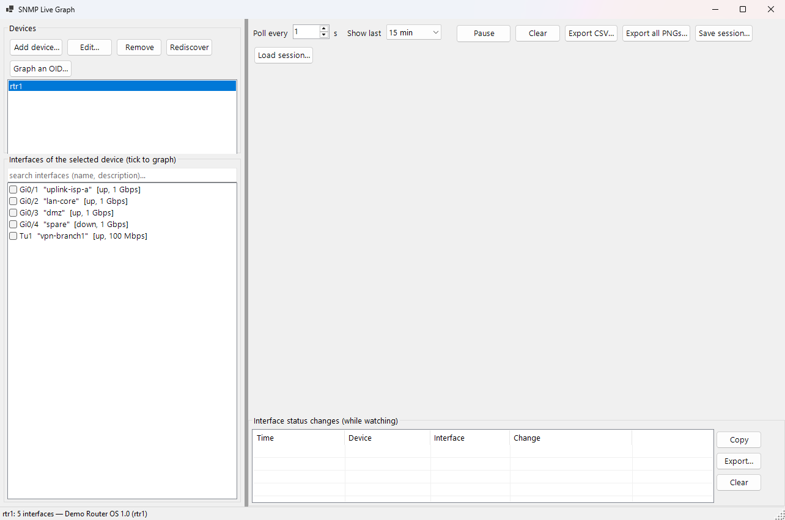
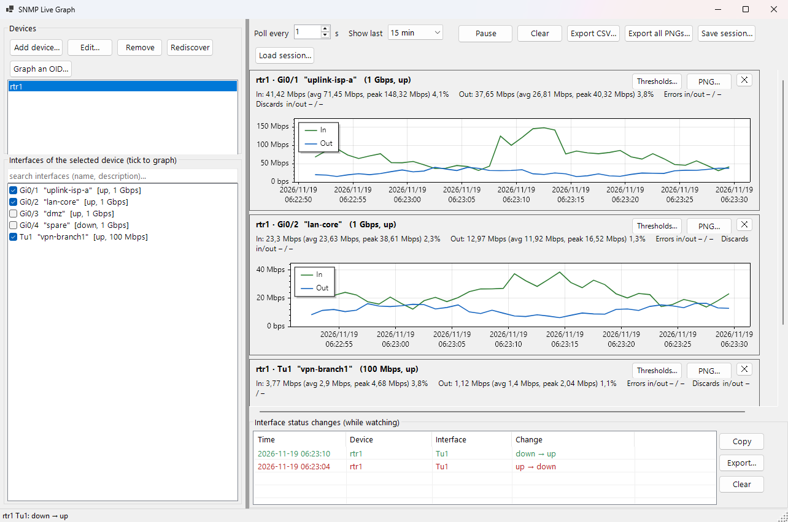

# SNMP Live Graph

Watch live traffic on a handful of interfaces across a few devices — no server, no database, nothing to install. A free stand-in for the old real-time bandwidth monitors.

[](https://github.com/RowShack/WinTools/releases/tag/snmp-live-graph-v0.1.0) &nbsp; **[Download from the release page](https://github.com/RowShack/WinTools/releases/tag/snmp-live-graph-v0.1.0)**


*A device added and its interfaces discovered, ready to tick for graphing (demo router on 127.0.0.1).*


*Live graphs for three interfaces, with the interface up/down changes logged below.*

## Features

- **Devices**: SNMP v2c (community) or v3 (user, auth SHA / SHA-256, privacy AES-128). A *Test* button shows sysName, sysDescr and uptime
- **Interface discovery** via IF-MIB / ifXTable: name, alias (description), speed, oper status; searchable list with checkboxes
- **Polling** every 1–60 s, one batched request per device. Uses 64-bit counters (`ifHCInOctets` / `ifHCOutOctets`), falls back to 32-bit with wrap handling. A device restart (sysUpTime going backwards) or counter reset skips that one sample instead of drawing a spike
- **Live chart per interface** (in / out bits per second), with utilisation % of `ifHighSpeed`, errors/s and discards/s, plus current / average / peak
- Several interfaces from several devices on one screen; pause, clear, 5 min / 15 min / 1 hour window (kept in memory only)
- **Threshold lines** (per interface tile, *Thresholds…* button): optional utilisation % and errors/s levels, drawn as dashed lines on the chart (errors/s on a right-hand axis). While the latest sample is above a level the tile turns red and says which one. Saved in sessions
- **Graph an OID** (*Graph an OID…* under Devices): any numeric OID of the selected device as its own tile, e.g. CPU %, session count, temperature, storage used. Shows the value over time; tick *Treat as a counter* to graph its per-second rate instead, and use *multiply by* to rescale (e.g. 0.1 for tenths). Presets: FortiGate (`fgSysCpuUsage`, `fgSysSesCount`, `fgSysMemUsage`), Cisco (`cpmCPUTotal5secRev`), HOST-RESOURCES-MIB (`hrProcessorLoad`, `hrStorageUsed`, `hrStorageSize`). *Test* reads the OID once; for a table column given without a row index it picks the first row and tells you how many exist. Missing OIDs and non-numeric values (text, IP addresses) show a clear message on the tile instead of a graph. Saved in sessions
- **Interface status change log**: while polling, `ifOperStatus` is checked on every poll and each change (up, down, dormant …) is logged with a timestamp in the pane at the bottom; *Copy* puts it on the clipboard, *Export…* writes CSV or TXT. The first value seen is only a baseline, so nothing is logged just for starting. The log is in memory only
- **Export**: visible data to CSV (OID tiles go to a second `…-oids.csv` file next to it), charts to PNG (per tile or all)
- **Sessions**: save and load devices, selected interfaces, thresholds and OID tiles. Community strings and SNMPv3 passwords are encrypted with Windows DPAPI for your user account

## Requirements

Windows 10/11, no admin rights. UDP 161 must be reachable and the device must allow this PC in its SNMP access list.

## Notes

- Rates are computed from counter differences between polls, so the first sample after starting (or after a restart) shows nothing.
- SNMPv3 has been written against the library's documented API but, unlike v2c, has **not** been tested against a real device yet.
- Libraries: [Lextm.SharpSnmpLib](https://github.com/lextudio/sharpsnmplib) (MIT) and [ScottPlot](https://scottplot.net) (MIT).

- Preset OIDs were checked against the published MIB definitions (FORTINET-FORTIGATE-MIB, CISCO-PROCESS-MIB, HOST-RESOURCES-MIB) but not against every firmware version. Table-based presets (Cisco, hrProcessorLoad, hrStorage*) need the row index of your device; `cpmCPUTotal5secRev` is marked deprecated in the MIB but is still widely implemented.
- Status changes are only detected while polling; a link that flaps between two polls is not seen.

## Build

```bash
dotnet test apps/snmp-live-graph/tests
dotnet publish apps/snmp-live-graph/gui -c Release -r win-x64 --self-contained true -p:PublishSingleFile=true -p:IncludeNativeLibrariesForSelfExtract=true -o apps/snmp-live-graph/publish
```

The tests include a small in-process SNMP v2c agent, so the real client, discovery and poller code run end to end.
