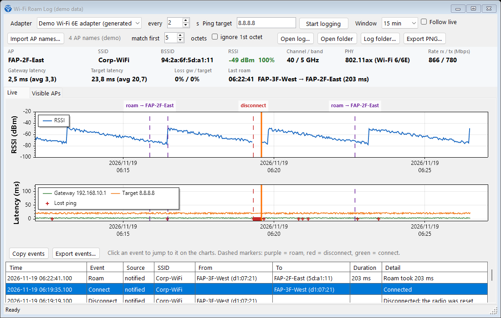
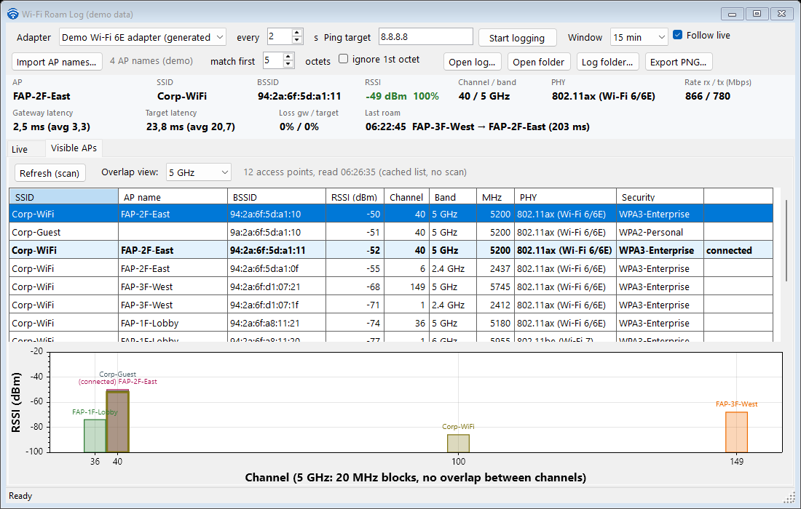

# Wi-Fi Roam Log

Records what your Wi-Fi was doing over time (signal, access point, channel, roams, disconnects, latency and packet loss) so that "the Wi-Fi was slow at 10:15" can be matched to an AP roam, weak signal or loss. Leave it running in the system tray all day, then open the log and look at 10:15.

[](https://github.com/RowShack/WinTools/releases/tag/wifi-roam-log-v0.1.0) &nbsp; **[Download from the release page](https://github.com/RowShack/WinTools/releases/tag/wifi-roam-log-v0.1.0)**

**Live view:** signal and latency on one time axis, with roams and disconnects as vertical markers.



**Visible APs:** neighbouring access points with RSSI and channel, plus a channel-overlap view.



*(Screenshots use generated demo data: `WifiRoamLog.exe --demo`.)*

## Features

- **Every N seconds (default 2):** SSID, BSSID, RSSI (dBm) and signal %, channel, band (2.4 / 5 / 6 GHz), PHY type, rx/tx link rate, using the Windows Native Wifi API (`wlanapi.dll`). Several Wi-Fi adapters: pick one.
- **Event log:** connect, disconnect, roam start / roam end (old AP → new AP and how long the roam took), connection failures with the Windows reason text. Events are marked **notified** (Windows told us) or **inferred** (the BSSID changed between two samples inside the same SSID; some drivers never send roam notifications). A notification always wins over an inference for the same event. An SSID change is logged as a new connection, not as a roam. Back-and-forth roams are flagged as "ping-pong".
- **Latency:** every second, in parallel, a ping to the default gateway (found automatically, re-detected if it changes) and to one target you choose (default 8.8.8.8, or an internal server). Latency and loss per target.
- **Live view:** RSSI chart over latency chart on one time axis, roam / disconnect / connect events as vertical markers with labels, visible window 5 min / 15 min / 1 h / 4 h / All, and a status header (SSID, AP name, BSSID, RSSI, channel/band, PHY, rates, gateway and target latency, loss %, last roam). Drag / scroll on a chart to pan and zoom (this stops "Follow live"). Click a row in the events table and both charts jump to that moment.
- **AP names:** import a CSV (`BSSID prefix, AP name, location`) so the header, charts and tables show `FAP-2F-East` instead of a MAC. See *AP name file* below.
- **Logging:** everything is appended to CSV files and flushed on every row, so a crash or power loss loses at most the current line. Each session gets its own timestamped folder under `Documents\WifiRoamLog` (change it with *Log folder…*). *Open folder* opens it. *Open log…* loads an earlier session into the same charts and tables.
- **Export:** *Copy events* / *Export events…* (CSV or TXT; select several rows to export just those), *Export PNG…* of both charts.
- **System tray:** the tray icon menu starts/stops logging; its tooltip shows the current AP and RSSI. Closing the window while logging asks once whether to keep logging in the tray (the answer is remembered; change it in the tray menu). *Exit* in the tray menu stops logging and finalises the files. Command-line switches: `--minimized` (start in the tray) and `--autostart` (start logging immediately).
- **Visible APs tab:** all BSSIDs the adapter currently knows, with SSID, AP name, RSSI, channel, band, security, plus a channel overlap view (2.4 GHz channels 1-14 with their overlap; 5 and 6 GHz as 20 MHz blocks).

## Requirements

- Windows 10 / 11 with a Wi-Fi adapter and the *WLAN AutoConfig* service running (it is by default on any PC with Wi-Fi).
- **Runs as a normal user. No administrator rights, no driver, no installer, no service.** The exe has no elevation manifest.
- Single self-contained portable `WifiRoamLog.exe` (.NET runtime included).

## Windows 11: Location permission

Newer Windows 11 builds hide the network name (SSID) and the AP address (BSSID) from apps unless Location access is switched on, and some calls return "access denied". Without it the app cannot tell APs apart and cannot detect roams. When it sees a connected adapter with a blank SSID/BSSID (or an access-denied error) it shows a yellow banner with a button that opens the right Settings page. By hand:

1. **Settings > Privacy & security > Location**
2. Turn on **Location services**
3. Turn on **Let desktop apps access your location** (scroll down if it is not visible)

The banner disappears by itself as soon as the data is readable. The app does not use or store your location. It only needs the permission because Windows ties Wi-Fi network names to it. *The app never changes this setting for you.*

## Usage

1. Run `WifiRoamLog.exe`. Pick the Wi-Fi adapter, the ping target and the sample interval (these are locked while logging).
2. Optional: *Import AP names…* (see below). Change *match first N octets* / *ignore 1st octet* if names do not match.
3. Press **Start logging**. The charts fill in; the files appear in the session folder shown in the status bar.
4. Close the window (keeps logging in the tray if you say yes) or use the tray icon. **Stop logging** or tray **Exit** ends the session.
5. Later: *Open log…*, pick `samples.csv`, `events.csv` or `pings.csv` of a session, and use the window buttons and the events table to find the time you care about. *Back to live* returns to the running session.

Reading a roam: look at the **Events** table for `Roam` rows. `Duration` is how long Windows says the roam took (only for *notified* roams). In the charts, a purple dashed line is a roam; RSSI usually jumps up right after it, and gateway latency spikes or lost pings (red crosses) around it mean the client was stalled while moving. A line of roams in a short time, or rows flagged "ping-pong", means the client is flapping between two APs (look at the RSSI of both, the roaming aggressiveness of the client, and AP power levels). A `Disconnect` followed by `Connect` is not a roam: the client lost the link and re-joined.

## AP name file

A plain CSV, comma separated (a semicolon or tab also works), with an optional header row. A line starting with `#` is a comment. Columns:

| Column | Meaning |
|--------|---------|
| BSSID prefix | 1 to 6 octets, written `94:2a:6f:5d:a1`, `94-2a-6f-5d-a1` or `942a6f5da1` |
| AP name | shown in the charts and tables |
| Location | optional free text |

```csv
BSSID prefix,AP name,Location
94:2a:6f:5d:a1,FAP-2F-East,Floor 2 east wing
94:2a:6f:d1:07,FAP-3F-West,Floor 3 west wing
```

`sample-ap-map.csv` in this folder is a ready-to-edit example. Lines that cannot be read are skipped and reported after the import.

**Virtual BSSIDs.** One physical AP advertises a different BSSID for each SSID and radio, and usually only the last octet (sometimes only its low bits) differs. So the match uses only the first *N* octets of the BSSID (default **5**, i.e. it ignores the last octet), where *N* is set with *match first N octets*. Entries shorter than *N* are compared at their own length; if several entries match, the longest one wins. Some controllers also change the first octet for extra SSIDs (for example `94:…`, `9a:…`, `a2:…` on the same AP); tick **ignore 1st octet** for those.

## What is in the log folder

`samples.csv` (one row per sample: time, state, SSID, BSSID, AP name, RSSI, signal %, channel, frequency, band, PHY, rx/tx Mbps, error code), `events.csv` (time, event, source notified/inferred, SSID, old/new BSSID and AP, duration, detail), `pings.csv` (time, target gateway/target, address, RTT ms, status; an empty RTT is a lost ping) and `session.txt` (start/stop time and settings). Times are local time. The CSVs are UTF-8 with a byte-order mark, so Excel opens them correctly.

**Privacy: on many PCs *Documents* is redirected to OneDrive, so the default log folder is then synced to the cloud; choose another folder with *Log folder…* if that is not what you want. The logs contain your SSIDs, BSSIDs (AP MAC addresses), the names of your access points and your gateway IP, plus a time line of where the laptop was connected. Treat the files (and exported PNGs) accordingly before attaching them to tickets or sending them outside your organisation.** Nothing is uploaded or looked up online by the app.

## What the app touches on your system

It only **reads** Wi-Fi state and sends pings. It does not connect, disconnect, edit profiles or change any setting.

- `WlanScan` (ask the driver for a fresh scan) is **never** called during logging. It is called only when you press *Refresh (scan)* on the Visible APs tab, and then at most once per 15 seconds. Repeated scans make Wi-Fi clients leave the channel to listen elsewhere, which can disturb roaming and throughput, so keep the Visible APs tab for spot checks. The normal logging reads the cached BSS list and never scans.
- On stop and on exit the notification registration is removed, the pings stop, and the WLAN handle is closed. Nothing stays running. Settings (adapter, target, interval, prefix length, tray choice, last AP file path) are kept in `%AppData%\WifiRoamLog\settings.json`; it holds no secrets.

## Limits and caveats

- **Roam notifications depend on the driver.** The app listens for Windows' roam start/end notifications and, as a fallback, infers a roam when the BSSID changes between samples. The inferred ones have no duration and are only accurate to the sample interval. A roam that goes away and back inside one interval is invisible to inference.
- The registration for Wi-Fi notifications was verified on real hardware, but the parsing of real connect / disconnect / roam notifications has only been tested with simulated notifications. If roams are not logged as "notified" on your driver, the "inferred" events are the fallback. Please report what you see.
- RSSI comes from the adapter; different adapters and drivers report on different scales. "Signal %" is Windows' own quality value.
- Pings are ICMP; some networks drop or rate-limit ICMP to the internet, which shows up as loss on the target but not on the gateway.
- The latency chart shows the target's address as the legend text; a host name is resolved once a minute.

## Libraries

[ScottPlot 5](https://github.com/ScottPlot/ScottPlot) (MIT licence) for the charts. No other runtime dependencies.

## Build

```bash
dotnet test apps/wifi-roam-log/tests
dotnet publish apps/wifi-roam-log/gui -c Release -r win-x64 --self-contained true -p:PublishSingleFile=true -p:IncludeNativeLibrariesForSelfExtract=true -o dist/wifi-roam-log
```

`WifiRoamLog.exe --demo` shows generated data (and lets you click *Start logging* against a fake Wi-Fi source; nothing is written to disk). The charts use SkiaSharp, whose native library must travel with the exe: always check the published single file, not loose DLLs.
