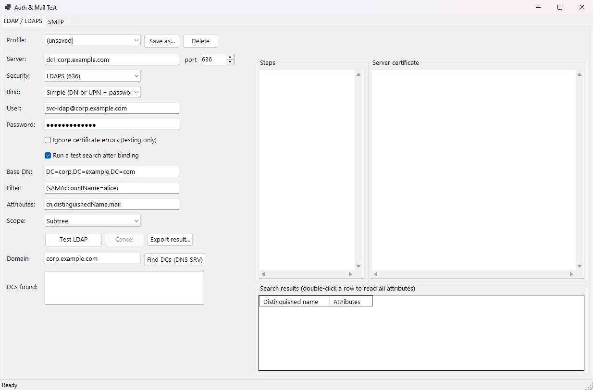
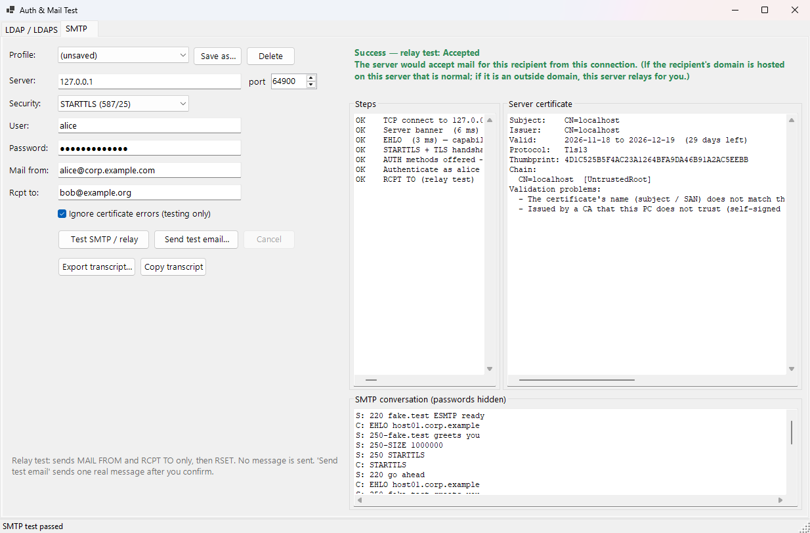

# Auth & Mail Test

Two testers in one window that explain *why* something fails, not just that it did: **LDAP/LDAPS** and **SMTP**.

[](https://github.com/RowShack/WinTools/releases?q=auth-mail-test-v&expanded=true) &nbsp; **[Download from the release page](https://github.com/RowShack/WinTools/releases?q=auth-mail-test-v&expanded=true)**


*LDAP tab, ready to test: server, security, bind and search settings (demo values, password masked).*


*SMTP tab after a STARTTLS test against a local demo server: step list, certificate details and the SMTP conversation.*

## LDAP tab

- Modes: LDAP 389, LDAPS 636, StartTLS. Binds: Negotiate/Kerberos (current Windows user or supplied credentials), Simple, Anonymous.
- Step-by-step result with timings: **DNS → TCP → TLS → bind → optional search**, stopping at the first failure.
- Certificate details: subject, issuer, SANs, validity and days left, chain, and validation problems in plain English (untrusted CA, name mismatch, expired, missing intermediate...).
- Active Directory bind errors decoded: `data 52e` invalid credentials, `525` user not found, `530/531` logon-hours / workstation restriction, `532` password expired, `533` disabled, `701` account expired, `773` must reset password, `775` locked out. Other LDAP result codes get explanations too.
- Test search: base DN, filter, attributes, scope → results grid.
- **Find DCs**: looks up `_ldap._tcp.dc._msdcs.<domain>` SRV records; double-click a DC to use it.

## SMTP tab

- Port 25 / 465 / 587; security None, SSL on connect, STARTTLS; optional AUTH (PLAIN / LOGIN).
- Shows the full SMTP conversation: banner, EHLO capabilities, STARTTLS, certificate, AUTH methods offered. **Passwords never appear in the transcript.**
- **Relay test**: MAIL FROM + RCPT TO, then RSET. No message data is ever sent.
- **Send test email** sends one real message through MailKit, only after you confirm.
- Hints for common failures: 530 auth required, 535 bad credentials / basic auth disabled (Microsoft 365), 550 relay denied, 554 blocked IP, TLS mismatches, port 25 blocked by ISPs.
- Export / copy the transcript as text.

## Saved profiles

Profiles live in `%AppData%\WinTools\AuthMailTest\profiles.json`. Passwords are encrypted with Windows DPAPI for your user account only (a profile copied to another PC or user can't be decrypted — re-enter the password).

## Requirements

Windows 10/11, no admin rights. Negotiate bind uses the Windows LDAP client.

## Notes

- The SMTP conversation uses a small built-in client (so that relay tests can stop before DATA and the full transcript can be shown); MailKit is used for the actual test email.
- "Ignore certificate errors" is for testing only. A simple bind over plain LDAP (389) sends the password unencrypted and asks for confirmation first.

## Build

```bash
dotnet test auth-mail-test.Tests
dotnet publish auth-mail-test -c Release -r win-x64 --self-contained true -p:PublishSingleFile=true -p:IncludeNativeLibrariesForSelfExtract=true -o auth-mail-test/publish
```
