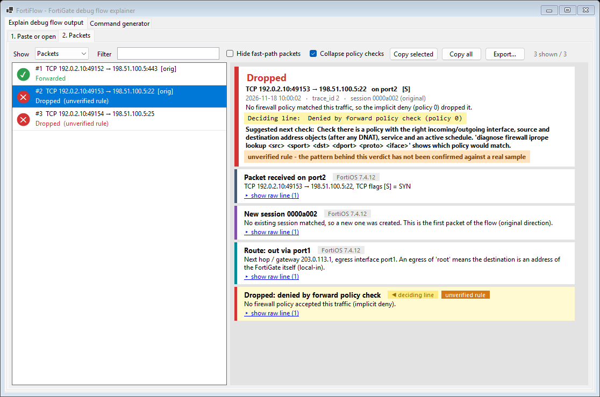

# FortiFlow

Paste the output of FortiGate `diagnose debug flow` and get a readable, step-by-step explanation of what happened to each packet: received → session → route → policy → NAT → IPsec → offload → egress, with a verdict (forwarded / dropped / local-in), the deciding line highlighted, a plain-English explanation and a suggested next check.

 <!-- screenshot placeholder: packet list on the left, step cards on the right -->

## Requirements

- Windows 10/11 x64. The published exe is self-contained, so no .NET install is needed.
- **No administrator rights needed.** FortiFlow only reads text you give it; it changes nothing on the PC and talks to no network. There is no manifest and no "restart as administrator" banner.

## Usage

1. Capture on the FortiGate over SSH (see the **Command generator** tab, which writes the exact commands for you), or export the log from the web GUI. Copy the output.
2. Paste it on the *Paste or open* tab, or use **Open .txt / .log / .csv…**, then press **Analyze** (Ctrl+Enter).
3. The *Packets* tab lists every packet with a verdict icon: green ✓ forwarded, red ✕ dropped, blue ⌂ local-in (traffic to the FortiGate itself), grey ? outcome not visible. Click a packet to see its timeline.

Supported input (detected automatically, mixed noise tolerated):

| Format | Looks like |
|---|---|
| Web GUI CSV export | `Time,Message` rows (UTF-8 BOM, bare packet-number separator lines) |
| CLI with function names | `id=20085 trace_id=1 func=print_pkt_detail line=5842 msg="..."` (grouped by `trace_id`) |
| CLI plain messages | `vd-root:0 received a packet(...)` etc. without prefixes (a new packet starts at each `received a packet(` line) |

Prompts (`FGT # ...`), timestamps, blank lines, CRLF, `--More--` and terminal-wrapped lines are tolerated. Lines no rule recognises are kept and shown raw on the timeline (grey "Unrecognised line" card).

Toolbar on the *Packets* tab:

- **Show: Packets / Sessions** - sessions link a request and its reply through the session id (`session-8c70da9f` / `id-8c70da9f`) and list their packets in order with direction (original / reply). Long sessions show full timelines for the first 8 packets only; select a packet in Packets mode for the rest.
- **Filter** - matches addresses, ports, interface, policy id, tunnel, verdict, card text.
- **Hide fast-path / offloaded** - hides packets that only show `enter fast path` or an NPU offload attempt (established sessions; nothing more to see).
- **Collapse policy checks** - folds the long run of `checked ... ret-no-match` lines into one card such as *Policy 281 matched after checking 5 others*; untick to see every check.
- **Copy selected / Copy all / Export…** - clipboard and files (TXT summary, CSV with one row per packet, HTML report) for the packets currently shown.

Every card has a *show raw lines* link. Cards produced by an **unverified rule** carry an orange badge, and the summary says so when the verdict itself depends on one.

### How the verdict is decided

The verdict comes from the outcome of the whole packet block, never from the first `act-drop` line. For packets sent to the FortiGate itself (route `via root`) the policy lists contain several groups; a group can end in `act-drop` and the next one in `act-accept`, and the session still works. In order:

1. an explicit drop message (reverse path check fail, denied by forward policy check, ...) → **Dropped**
2. a `send out` / `send to` / `enter fast path` / offload line → **Forwarded**
3. `Allowed by Policy-N` → **Forwarded**
4. route via `root` → **Local-in**, unless the *last* policy result is a drop → **Dropped**
5. the last policy result says drop → **Dropped**
6. otherwise **Outcome not visible** (for example a truncated trace)

A packet with `no session matched` is *not* reported as dropped on that line alone (it is typically a mid-stream TCP packet of a timed-out session); the card explains this.

### Command generator tab

Fill in source / destination / port / protocol / VDOM / packet count and get the start sequence and the stop-and-reset sequence, each with a Copy button:

```
diagnose debug reset
diagnose debug flow filter saddr 192.0.2.10
diagnose debug flow filter daddr 198.51.100.5
diagnose debug flow filter dport 443
diagnose debug flow filter proto 6
diagnose debug flow show function-name enable
diagnose debug flow trace start 20
diagnose debug enable
```
```
diagnose debug disable
diagnose debug reset
```

A filter is required - the generator refuses to produce an unfiltered trace. With only one address it uses `addr` so replies are traced too. The tab also explains NPU offload (established sessions are not traced; `diagnose sys session filter` + `clear` only on a test host), that the web GUI CLI console may not stream debug output (use SSH), and to always disable debug afterwards. `filter vd` takes the VDOM *index*; enter `root` or the number from `diagnose sys vd list`.

## Rules file (add patterns without recompiling)

All message patterns, card types, explanations and next checks live in JSON. The default set is embedded in the exe (`forti-flow.Core/rules/default-rules.json`). To add or change patterns:

1. **Rules ▾ → Save built-in rules as…** and keep the copy as a starting point (or write a new file with just your rules).
2. **Rules ▾ → Choose rules file…** (the choice is remembered). A file named `forti-flow.rules.json` next to the exe is picked up automatically.

Your rules are tried *before* the built-in ones, and a rule with the same `id` replaces the built-in rule. Set `"replaceDefaults": true` at the top level to ignore the built-in rules completely. A broken file never crashes the app: invalid JSON falls back to the built-in rules and a message says why; a single bad regex only skips that rule.

```json
{
  "schemaVersion": 1,
  "replaceDefaults": false,
  "verdicts": { "dropped": { "title": "Dropped", "explain": "...", "nextCheck": "..." } },
  "rules": [
    {
      "id": "drop-example",
      "pattern": "^Denied by forward policy check \\(policy (?<policy>\\d+)\\)",
      "card": "drop",
      "title": "Dropped: implicit deny (policy {policy})",
      "text": "No firewall policy accepted this traffic.",
      "effect": "drop",
      "explain": "Shown in the summary header when this line decides the verdict.",
      "nextCheck": "Shown as 'Suggested next check'.",
      "versions": ["7.4.12"],
      "verified": true
    }
  ]
}
```

| Field | Meaning |
|---|---|
| `id` | Unique name. Reusing a built-in id replaces that rule. |
| `pattern` | .NET regular expression matched against ONE message (after timestamps, CSV columns and `id= trace_id= func= msg=` prefixes are removed). Use named groups `(?<name>...)`; they feed `title`/`text` as `{name}`. First matching rule wins. |
| `card` | Card type / colour: `received`, `session`, `route`, `policy`, `policy-check`, `nat`, `ipsec`, `offload`, `egress`, `drop`, `detail`, or anything else (grey). |
| `title`, `text` | Card heading and body; `{group}` placeholders. Extra variables: `{raw}` (the whole line), `{proto_name}`, `{extra}`, `{policy_label}`, plus the packet's `{src} {sport} {dst} {dport} {iface}`. |
| `effect` | What the line means for the verdict (see below). Default `none`. |
| `when` | Optional condition: `reply`, `original`, `new-session`, `existing-session`, `no-session`, `local-in`. The rule is skipped unless it holds (used to tell an SNAT reversal from a VIP). |
| `minor` | `true` folds the line into the collapsed *Technical details* card. |
| `explain`, `nextCheck` | Plain-English explanation and suggested next check shown in the packet summary when this line decides the verdict. |
| `versions` | FortiOS versions this pattern was seen in (shown on the card). |
| `verified` | `false` marks a rule written from knowledge rather than from a real sample; the UI shows an "unverified rule" badge. |
| `notes` | Free text for you. |

`effect` values: `received` (packet header: needs groups `vd proto src sport dst dport iface`, optional `flags` / `itype icode`), `new-session` / `existing-session` (group `session`, and `direction` for existing), `no-session`, `route` (groups `gw egress`; egress `root` means local-in), `policy-check` (groups `gnum policy ret act`, folded into one card), `policy-match` (`policy act`), `policy-allow` (`policy`), `decision` (`act`: accept/drop, the last one wins), `drop` (explicit drop reason), `forward` (group `dev`: egress line), `fast-path`, `offload`, `ipsec` (group `tunnel`), `none`.

The top-level `verdicts` object holds the default title / explanation / next check per verdict (`forwarded`, `forwarded-offload`, `local-in`, `local-in-existing`, `dropped`, `unknown`).

### Rules that still need real samples

Seen in the 7.4.12 samples and marked verified: packet received (TCP/UDP/ICMP), new/existing session, no session matched, route, policy routing, policy checks and matches, `Allowed by Policy-N`, SNAT and the NAT reversal on the reply, IPsec enter/output/encrypt/selector, `send out` / `send to`, fast path, NPU offload lines.

**Unverified** (written from FortiOS knowledge; please supply real output for each, from several FortiOS versions):

| Rule id | Pattern it expects |
|---|---|
| `drop-rpf` | `reverse path check fail, drop` |
| `drop-policy0` | `Denied by forward policy check (policy 0)` (implicit deny) |
| `drop-iprope-in` | `iprope_in_check() check failed [on policy N], drop` |
| `drop-no-policy` | `no matching policy` / `no policy matched` |
| `nat-vip-new` | `DNAT a->b` on a *new* session (VIP) |

## Build

Needs the .NET 10 SDK.

```
dotnet test WinTools.slnx
dotnet publish forti-flow -c Release -r win-x64 --self-contained true -p:PublishSingleFile=true -p:IncludeNativeLibrariesForSelfExtract=true -o dist/forti-flow
```

Layout: `forti-flow/` (WinForms GUI), `forti-flow.Core/` (input reader, rules engine, analyzer, command generator, exporters), `forti-flow.Tests/` (xUnit, run against the sanitised files in `forti-flow/samples/`, plus hand-written CLI fixtures using documentation IPs). No third-party libraries.

## Samples

`samples/` holds two sanitised web-GUI exports from FortiOS 7.4.12 (100 and 1000 packets). The CLI-format fixtures in the test project are hand-written from the documented FortiOS format, not captured from a device.
