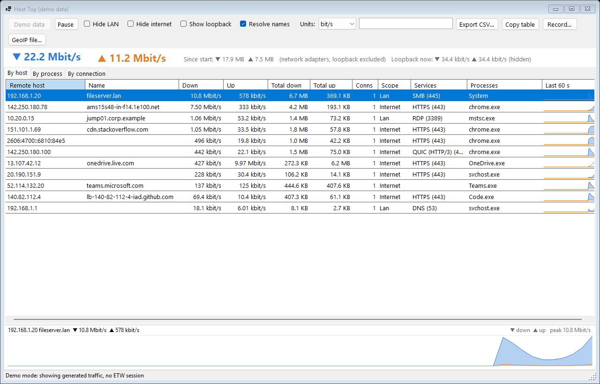

# Host Top

A live **"who is using the bandwidth right now"** view for Windows, in the spirit of iftop / nethogs / pftop: throughput per **remote host**, per **process** and per **connection**, updated every second. It listens to Windows' own kernel network events (ETW); it installs no driver and no packet capture library.



*(The screenshot uses generated demo data: `HostTop.exe --demo`.)*

## Features

- Totals bar: overall download / upload of the machine, plus session totals
- **By host**: remote IP, reverse-DNS name (async, cached, never blocks the UI), down/up rate, totals, active connections, services, processes involved
- **By process**: name, PID, path, down/up rate, totals, remote hosts contacted
- **By connection**: process, protocol, local → remote endpoint, rates, service name
- Sort by any column, text filter (space = AND, `-word` excludes, e.g. `chrome 443 -dns`), *Hide LAN* / *Hide internet* / *Show loopback*, *Pause* (freezes the display; capture continues), bit/s or bytes/s
- 60-second sparkline per row, and a larger one for the selected row
- Well-known service names from the port (HTTPS 443, SMB 445, RDP 3389, DNS, QUIC, ...)
- **Export CSV** of the current table (rates in bytes/s, totals in bytes; `.txt` gives tab-separated), **Copy table** to the clipboard
- **Record…**: writes one CSV line per active host per second for N minutes
- **GeoIP file…** (optional): load your own offline CSV (`start_ip,end_ip,country[,asn/org]`, e.g. the free DB-IP "IP to Country/ASN Lite" files). Nothing is looked up online or downloaded
- Right-click: copy IP, whois lookup (opens your browser), open host in browser, open process file location, kill process (asks first)

## Requirements and admin rights

Windows 10 / 11 or Server 2016+. **Administrator rights are required**: Windows only allows administrators to start an ETW session. The exe carries a manifest that asks for elevation at start (like pktmon-gui); it is useless without it.

## What ETW captures — and what it doesn't

The app enables **one** real-time ETW session (`WinTools-HostTop`) on the provider *Microsoft-Windows-Kernel-Network*. Each TCP or UDP send/receive reports the process ID, byte count and both endpoints.

- **TCP and UDP, IPv4 and IPv6** are covered. Counts are payload bytes handed to/from the TCP/IP stack per process, so they are close to, but not identical to, the bytes on the wire (no Ethernet/IP/TCP headers, no retransmissions counted separately). Expect small differences against your router or NIC counters.
- **UDP has no connections.** The "connection" for UDP is *local port + remote endpoint* (the local address is ignored because it can change with the interface used). Hosts and processes are unaffected.
- **Loopback** (127.0.0.1, ::1 and traffic to the machine's own address) is reported by Windows as ordinary connections. It never touches the network, so it is **hidden by default** and excluded from the totals bar; tick *Show loopback* to see it.
- **LAN vs internet**: RFC 1918, link-local, CGNAT (100.64/10), multicast, IPv6 ULA/link-local count as LAN. Everything else is internet. The hide toggles drop matching traffic from the tables from that moment on (rows already collected stay until they idle out); the totals bar always counts everything on the wire.
- **Not captured**: traffic that never goes through the Windows TCP/IP stack (some VPN/driver-level tunnels, kernel-mode offloads, packets forwarded by this machine acting as a router, ICMP/ping and other non-TCP/UDP protocols). Traffic inside a VPN appears as the VPN client's own UDP/TCP flow to the VPN server (plus the inner flows if the VPN uses a virtual adapter).
- **Short-lived processes**: a process's name and path are looked up when its PID is first seen and cached. A program that exits within milliseconds of its first packet may show as `PID n (exited)`. PID reuse is detected via the process start time, so a recycled PID gets its own row.
- Rows with no traffic for 5 minutes are dropped (totals of dropped rows are no longer listed, but the machine total keeps counting).

## Safety: nothing is left running

The ETW session is stopped when you press *Stop capture*, when the window closes and when Windows signs out. If the app is killed or crashes the session would keep running, so **at next launch any leftover `WinTools-HostTop` session is stopped automatically** (the status bar tells you). If you want to check by hand: `logman query -ets` (look for `WinTools-HostTop`) and `logman stop WinTools-HostTop -ets`.

## Usage

1. Run `HostTop.exe` and accept the UAC prompt. Capture starts straight away.
2. Look at *By host* for who is talking to you, *By process* for which program, *By connection* for the detail. Click a row to see its 60 s history at the bottom.
3. Type in the filter box, switch units, pause to inspect a moment, export or copy what you see.

`HostTop.exe --demo` shows generated traffic with no ETW session (useful for trying the UI without admin rights; build with `-p:UseAdminManifest=false` to skip the elevation request).

## Caveats (please read)

- The live ETW path (field order and port byte order of the provider's events, direction of source/destination on receive) is implemented from the documented event layout and unit-tested against synthetic payloads, but needs verification on real machines. If rates look swapped (download shown as upload) or ports look odd (e.g. 47873 instead of 443), please report it.
- Reverse DNS sends PTR queries for every remote IP you see, via your normal resolver. Untick *Resolve names* to avoid that.

## Libraries

[Microsoft.Diagnostics.Tracing.TraceEvent](https://github.com/microsoft/perfview) (MIT licence). No other runtime dependencies.

## Build

```bash
dotnet test host-top.Tests
dotnet publish host-top -c Release -r win-x64 --self-contained true -p:PublishSingleFile=true -p:IncludeNativeLibrariesForSelfExtract=true -o dist/host-top
```

For UI testing without elevation: `dotnet build host-top -p:UseAdminManifest=false`, then `HostTop.exe --demo`.
