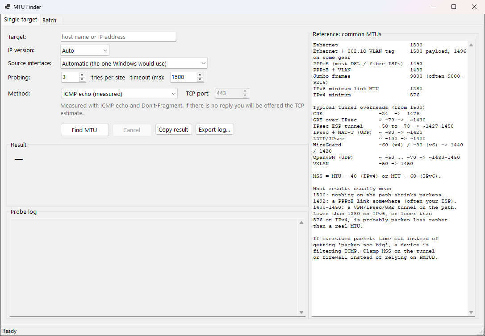
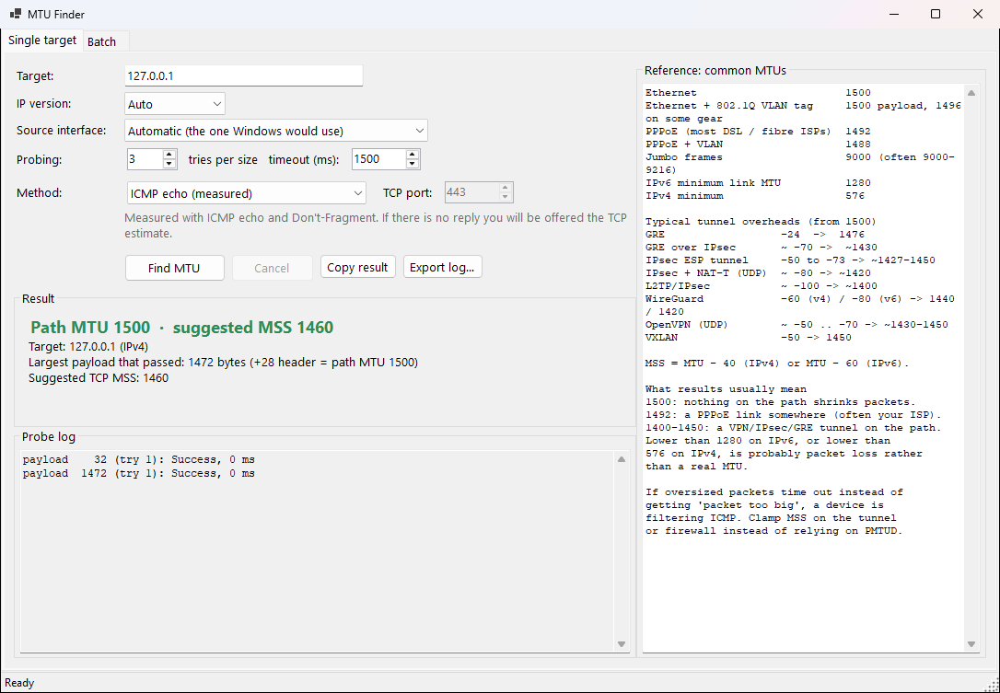

# MTU Finder

Finds the real path MTU to a destination and suggests a TCP MSS clamp — useful for VPN/IPsec, PPPoE and GRE problems.

[](https://github.com/RowShack/WinTools/releases?q=mtu-finder-v&expanded=true) &nbsp; **[Download from the release page](https://github.com/RowShack/WinTools/releases?q=mtu-finder-v&expanded=true)**


*Ready to use: enter a target and click Find MTU; the reference list of common MTUs is on the right.*


*Result for a loopback target: path MTU, suggested MSS and the probe log.*

## How it works

It sends ICMP echo requests with a growing/shrinking payload, with **Don't Fragment** set for IPv4, and binary-searches the largest size that gets an answer. Each size is tried several times so ordinary packet loss isn't mistaken for an MTU limit.

Result: largest working payload, **path MTU** (payload + 28 for IPv4, + 48 for IPv6), **suggested MSS** (MTU − 40 / − 60) and the local interface MTU for comparison.

## TCP estimate (optional, ESTIMATE only)

When ICMP is filtered the normal method has nothing to measure. Choose **Method: TCP connect (estimate only)** (or answer *Yes* when the tool offers it after a "no reply") and give an open TCP port (default 443). The tool connects with Don't-Fragment, reads the negotiated MSS from Windows (`SIO_TCP_INFO`), then sends single segments of increasing size on fresh connections and finds the largest one that is acknowledged without retransmission. Results read **"Estimated path MTU about N (TCP, estimate)"**.

**Treat it as a guess.** It can be wrong when a firewall, VPN or proxy clamps (rewrites) the MSS or terminates the TCP connection, in which case the real path MTU may be larger. It needs a port that stays open and does not reset on unexpected data,, and it sends a few kilobytes of zero bytes to that service, so only use it against hosts you are allowed to test. If the negotiated MSS is smaller than this machine's link allows, the tool says so. Needs Windows 10 1703 or later.

In the **Batch** tab, tick *TCP estimate when ICMP gets no reply* to fill the extra **TCP estimate (about)** column for hosts that did not answer ICMP.

## Features

- IPv4 or IPv6 (or automatic), choice of source interface
- Probe log showing every attempt (size, success / packet-too-big / timeout)
- Says "No reply — MTU can't be measured" when ICMP is blocked, instead of reporting a wrong number
- Warns when oversized packets are silently dropped (PMTUD black hole) rather than answered with "packet too big"
- Optional TCP-based path-MTU **estimate** for paths where ICMP is filtered (clearly marked as an estimate)
- Batch tab: list of targets → results table, export CSV, copy table
- Reference panel of common MTUs and tunnel overheads
- Copy result / export log

## Requirements & usage

- Windows 10/11, no admin rights needed (uses the Windows ICMP API, no driver)
- Type a host or IP, press **Find MTU**

## Notes

- Windows does not tell us the next-hop MTU in "packet too big" replies, so the search is a plain binary search (about 8–11 probes).
- IPv6 routers never fragment, so IPv6 uses the "packet too big" reply instead of the DF bit.
- Run `WINTOOLS_LIVE=1 dotnet test` to include the manual live-network smoke test.

## Build

Requires the .NET 10 SDK.

```bash
dotnet test mtu-finder.Tests
dotnet publish mtu-finder -c Release -r win-x64 --self-contained true -p:PublishSingleFile=true -p:IncludeNativeLibrariesForSelfExtract=true -o mtu-finder/publish
```
