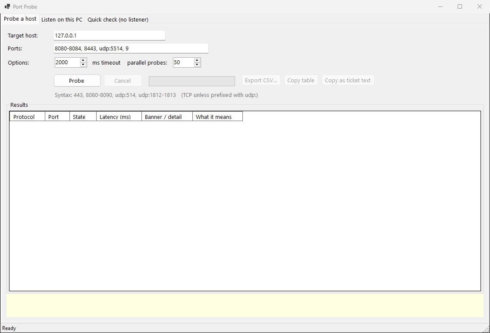

# Port Probe

Prove whether firewall rules work **end to end**: run a listener on one machine and a prober on another. One exe, three tabs.



## Tabs

**Listen on this PC** — open TCP/UDP listeners (`443, 8080-8090, udp:514, udp:1812`) on all or one interface. TCP listeners send a banner naming the tool and host; UDP listeners echo a signed reply. A live log shows who connected on which port. The tool detects whether Windows Firewall would block the listeners and (as administrator) can add temporary allow rules.

**Probe a host** — scan a target for the same port syntax and classify every port:

| State | Meaning |
|-------|---------|
| Open (PortProbe listener) | Reached our listener, banner verified — path is open |
| Open (other service) | Connected to something else (a real service, proxy, load balancer) |
| Refused | Host answered "nothing listening" (RST / ICMP unreachable) — **the packet reached the host**, no firewall is blocking it |
| Filtered | No answer — usually a firewall silently dropping traffic |
| Unreachable | A router/firewall rejected it or there is no route |
| No reply (UDP) | UDP gives no confirmation; open-but-silent and blocked look identical |

Each row explains itself in plain English. Export CSV, copy the table, or **Copy as ticket text** for a change request.

**Quick check** — list of `host:port` pairs, no listener needed: TCP connect plus TLS handshake, showing certificate subject, issuer, expiry, days left, TLS version and trust problems.

## Firewall rules & safety

- Rules are created only with the administrator's consent and only for the ports being listened on, in the group **"WinTools PortProbe"**.
- They are removed on **Stop**, when the window closes, and at the **next launch** if a crash left them behind (as administrator). To remove them by hand: `Remove-NetFirewallRule -Group 'WinTools PortProbe'`.
- Without administrator rights the tool still works; it just can't add rules.

## Requirements

Windows 10/11. Administrator only for the firewall-rule feature.

## Notes

- A closed port on *this* PC (loopback) takes about 2 seconds to report "refused" on Windows; remote hosts answer immediately.
- Firewall detection is a heuristic (profile state and default inbound action); it does not evaluate individual rules.
- Only scan hosts you are authorised to test.

## Build

```bash
dotnet test port-probe.Tests
dotnet publish port-probe -c Release -r win-x64 --self-contained true -p:PublishSingleFile=true -p:IncludeNativeLibrariesForSelfExtract=true -o port-probe/publish
```
