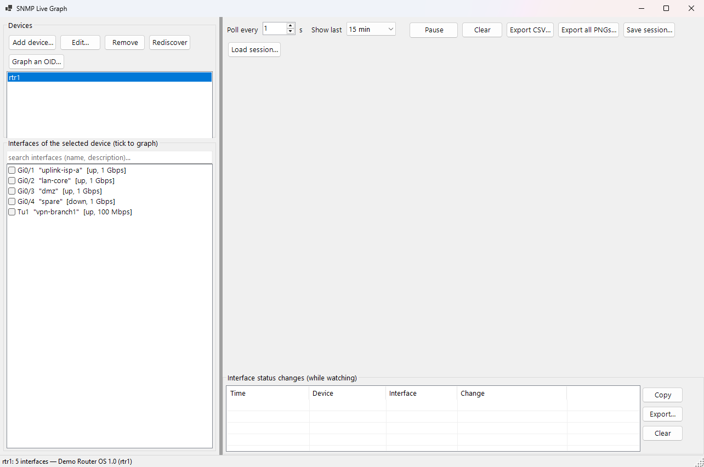

# SNMP Live Graph

Watch live traffic on a handful of interfaces across a few devices — no server, no database, nothing to install. A free stand-in for the old real-time bandwidth monitors.



## Features

- **Devices**: SNMP v2c (community) or v3 (user, auth SHA / SHA-256, privacy AES-128). A *Test* button shows sysName, sysDescr and uptime
- **Interface discovery** via IF-MIB / ifXTable: name, alias (description), speed, oper status; searchable list with checkboxes
- **Polling** every 1–60 s, one batched request per device. Uses 64-bit counters (`ifHCInOctets` / `ifHCOutOctets`), falls back to 32-bit with wrap handling. A device restart (sysUpTime going backwards) or counter reset skips that one sample instead of drawing a spike
- **Live chart per interface** (in / out bits per second), with utilisation % of `ifHighSpeed`, errors/s and discards/s, plus current / average / peak
- Several interfaces from several devices on one screen; pause, clear, 5 min / 15 min / 1 hour window (kept in memory only)
- **Export**: visible data to CSV, charts to PNG (per tile or all)
- **Sessions**: save and load devices + selected interfaces. Community strings and SNMPv3 passwords are encrypted with Windows DPAPI for your user account

## Requirements

Windows 10/11, no admin rights. UDP 161 must be reachable and the device must allow this PC in its SNMP access list.

## Notes

- Rates are computed from counter differences between polls, so the first sample after starting (or after a restart) shows nothing.
- SNMPv3 has been written against the library's documented API but, unlike v2c, has **not** been tested against a real device yet.
- Libraries: [Lextm.SharpSnmpLib](https://github.com/lextudio/sharpsnmplib) (MIT) and [ScottPlot](https://scottplot.net) (MIT).

## Build

```bash
dotnet test snmp-live-graph.Tests
dotnet publish snmp-live-graph -c Release -r win-x64 --self-contained true -p:PublishSingleFile=true -p:IncludeNativeLibrariesForSelfExtract=true -o snmp-live-graph/publish
```

The tests include a small in-process SNMP v2c agent, so the real client, discovery and poller code run end to end.
